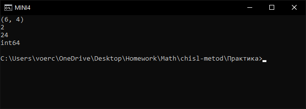
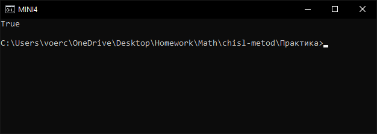
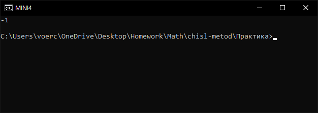
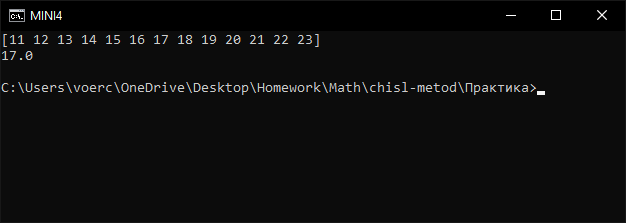
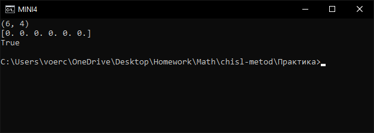

# 1

```python
import numpy as np

a = np.arange(24).reshape(6, 4)
print(a.shape)
print(a.ndim)
print(a.size)
print(a.dtype)
```



# 2

```python
import numpy as np

a = np.arange(24).reshape(6, 4)
b = a.reshape(4, 6)
c = b.reshape(2, 3, 4)
d = c.reshape(24)
print(np.array_equal(a.ravel(), d))
```



# 3

```python
import numpy as np

a = np.arange(24).reshape(6, 4)
col = a[:, 2]
col[0] = -1
print(a[0, 2])
```



# 4

```python
import numpy as np

a = np.arange(24).reshape(6, 4)
big = a[a > 10]
print(big)
print(big.mean())
```



# 5

```python
import numpy as np

a = np.arange(24, dtype=float).reshape(6, 4)
centered = a - a.mean(axis=1, keepdims=True)
print(centered.shape)
print(centered.sum(axis=1))
print(np.allclose(centered.sum(axis=1), 0))
```


